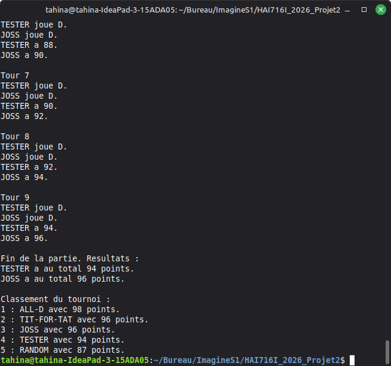
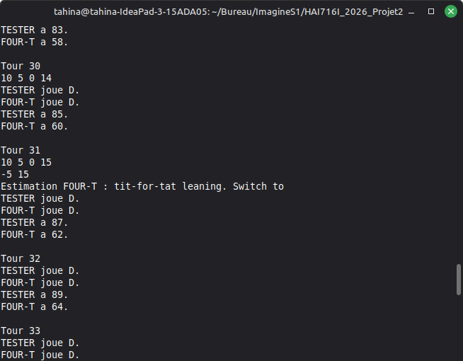
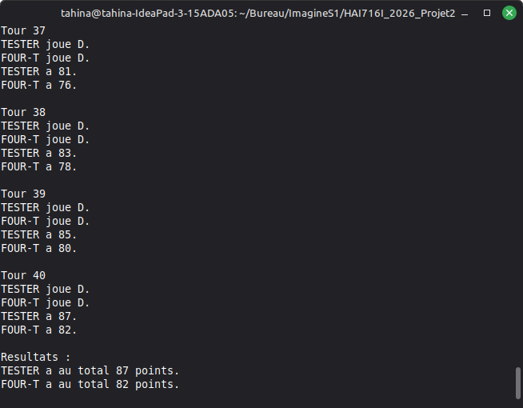
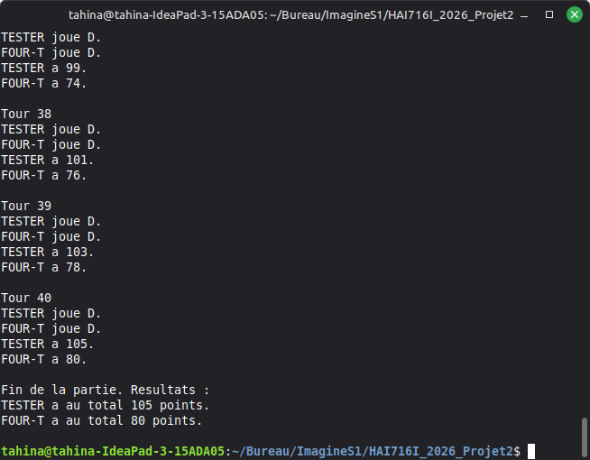
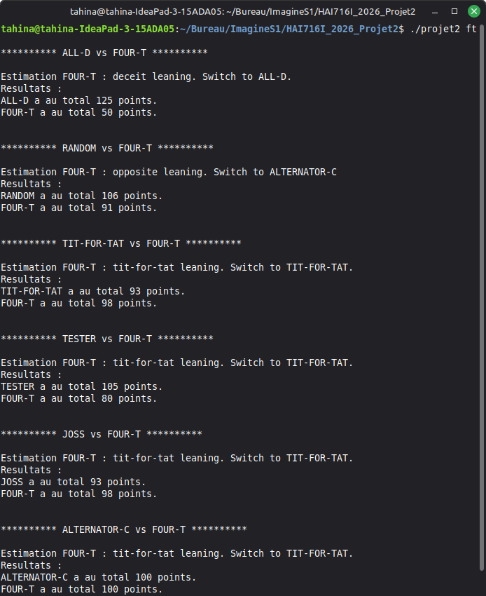
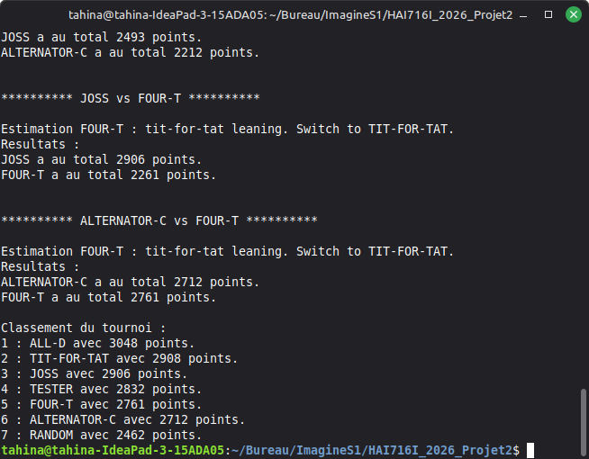
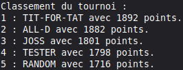
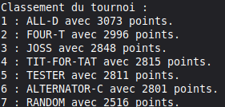

# Projet 2 HAI716I 2026 - Journal de bord - DOMBROWSKI Tahina

## Vendredi 13/11/2026 :
20 tours, ALL-D contre RANDOM, graine de 40.
Problèmes de relation main/StratPlayer (attributs définits const, dédoublage des variables hors classe)

Passage au tournoi tous contre tous, 10 tours pour lisibilité, graine 40.
TESTER ne faisait pas le résultat attendu car le compteur de C était mis à jour avant de savoir si C est effectivement joué.
Le tournoi fonctionne, il y a bien eu un JOSS démarrant avec D.

- ALL-D vs RANDOM : ALL-D gagne (si RANDOM joue C, ALL-D gagne 5, si RANDOM joue D, ALL-D gagne autant)
- ALL-D vs TIT-FOR-TAT : ALL-D gagne (trahison de 5 pour le premier tour pour ALL-D, puis autant)
- ALL-D vs TESTER : Egalite (Tester commence par D puis TIT-FOR-TAT)
- ALL-D vs JOSS : Egalite si Joss commence par D, ALL-D gagne sinon

TIT-FOR-TAT perd contre RANDOM car RANDOM trahit du tour 5 jusqu'à la fin, donc TIT-FOR-TAT ne récupère pas la différence.

Résultat du tournoi Axlrod 10 tours.

## Samedi 14/11/2026 :
10 tours, tous contre tous, graine 40.
J'ai mal lu le critère de classement du tournoi (je pensais que c'était par nombre de parties gagnées au lieu du nombre de points accumulés au total au cours du tournoi).
Le classement est le même. TIT-FOR-TAT perd contre ALL-D car ALL-D gagne contre tous, et JOSS bat TIT-FOR-TAT en commençant par D.

Nouvelles stratégies, toutes deux issues de mon imagination :
- ALTERNATOR-C : C au premier tour, puis effectue le choix opposé à celui qu'il a fait au tour précédent. Commence par C pour mettre en confiance les testeurs de coopération comme TESTER. Egalise les stratégies types TIT-FOR-TAT.
- FOUR-T : Ten Turn Trust Tester, effectue C durant les 5 premiers tours, puis D durant les 5 suivant, puis change de stratégie selon les réponses de l'adversaire au bout de ces 10 tours :
    * majoritairement C peu importe son choix : TESTER (essaye de soutirer des points) 
    * majoritairement D peu importe son choix : ALL-D (stratégie défensive)
    * majoritairement C s'il choisit C et majoritairement D s'il choisit D : TIT-FOR-TAT (réciproque par sécurité)
    * majoritairement D s'il choisit C et majoritairement C s'il choisit D : ALTERNATOR-C (peut trahir après une trahison)

A évolué en Thirty TTT (15 C puis 15 D puis changement de stratégie) : mallus des 15 tours de coopération. Avoir ALL-D comme stratégie après n'importe quelle décision aurait été plus efficace, mais moins intéressant. La stratégie la plus intéressante à étudier de base est TESTER. Un match test pour T = 10 puis pour T = 30 en 40 tours a été effectué :

FOUR-T paie le prix des T/2 choix de coopération pour l'estimation du comportement adverse : un écart se creuse lorsque T augmente. On pourrait envisager une estimation en jouant TIT-FOR-TAT, ou en alternant tous les 5 tours. Résultat des matchs FOUR-T (points remis à 0) :

Ajout de deux arguments : choix entre FOUR-T contre tous en 40 tours chacun, ou tournoi Axelrod de 200 tours chacun + afficher les choix/résultats de chaque tour ou juste le résultat de chaque partie.

Résultats du tournoi Axelrod avec les deux nouvelles stratégies :

Ajout de l'option de tournoi Axelrod 200 tours avec les cinq stratégies de bases :

TIT-FOR-TAT gagne bien cette fois. Il est battu par ALL-D dans le tournoi élargi car ALL-D gagne des points sur les stratégies qui choisissent régulièrement C (RANDOM, ALTERNATOR-C, les T/2 premiers tours de FOUR-T), ce qui lui permet de creuser un écart avec TIT-FOR-TAT grâce aux points de trahison. FOUR-T et ALTERNATOR-C n'ont battu que RANDOM dans le classement car ALTERNATOR-C prend beaucoup de trahison, et FOUR-T est générallement pénalisé durant le test C.

## Dimanche 15/11/2026 :
Modifications choisies : Bruit et Horizon inconnu, toutes deux des modifications ajoutant de l'aléa dans les parties, ce qui peut potentiellement démarquer les stratégies qui étaient à égalité ou avaient un avantage par rapport au nombre de tour. Ces modifications affecteront l'estimation de FOUR-T avec T = 30 (bruit) et ses chances de réussite (horizon inconnu).

Prédiction bruit 5% :
1. ALL-D (pas de changement significatif)
2. JOSS (peut peut-être battre TIT-FOR-TAT)
3. TIT-FOR-TAT
4. TESTER (le changement s'effectuera probablement plus sur la partie TIT-FOR-TAT)
5. FOUR-T (dépend de l'adversaire)
6. ALTERNATOR-C (le comportement ne change pas)
7. RANDOM (même comportement peu importe le changement)

Résultats :

A ma grande surprise, FOUR-T est classé deuxième. L'inversement de coup biaise l'estimation de FOUR-T, qui pense que la réponse de l'adversaire est celle du choix qu'il a fait initialement, et non de son inverse. Pour ce qui était initalement un TIT-FOR-TAT leaning avec une faible majorité de réponse réciproque, un changement peut renverser totalement la différence C-D, ce qui change entièrement la stratégie choisie par FOUR-T. De plus, un changement tôt durant la phase C face à TESTER active son mode TIT-FOR-TAT, le forçant ainsi à rester coopératif après le changement, au lieu de trahir une fois sur trois. Les stratégies ne savent pas que leurs propres ont été inversés, donc ALTERNATOR-C agit comme s'il a bien joué C au lieu de D s'il y a trois D d'affilé.

Prédiction horizon inconnu 95% :
1. ALL-D (pas de changement significatif)
2. JOSS (avantage du 10% par rapport à TIT-FOR-TAT)
3. TIT-FOR-TAT
4. ALTERNATOR-C (les stratégies en dessous commencent la plupart du temps par C)
5. TESTER (possibilité que TESTER perd un tour lui permettant de rattraper son test)
6. FOUR-T (dépend de l'adversaire)
7. RANDOM (même comportement peu importe le changement)

Résultats :

... J'ai clairement sous-estimé l'impact des 5% d'interromptre une partie. Il s'avère que certaines parties durent moins de 5 tours, tandis que d'autres durent plus de 20. Cela crée un déséquilibre conséquent, car ceux qui ont les tours les plus courts obtiennent le moins de points, et pour cette graine, ALL-D reçoit clairement ce désavantage.
